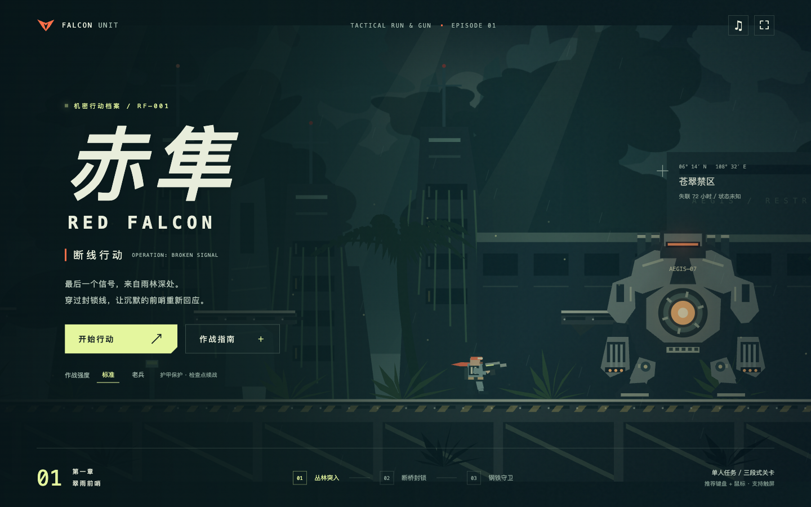

# 赤隼 · 断线行动

**RED FALCON — OPERATION: BROKEN SIGNAL**

原创的单人横版跑跳射击游戏，以经典动作游戏为灵感，重新设计第一关、角色、机械敌人与声音。浏览器原生 Canvas 2D + Web Audio，无运行时依赖，无远程素材请求。



## 运行

需要 Node.js 20 或更新版本，以及现代浏览器。项目没有 npm 依赖，无需安装依赖即可运行。

```sh
git clone https://github.com/aaronguostudio/red-falcon.git
cd red-falcon
npm run dev
```

打开 [本地游戏](http://red-falcon.localhost:4177)。推荐桌面浏览器全屏游玩。

`dist/` 直接存放 HTML、CSS 和 JavaScript 源码，不是生成的构建产物。将该目录发布到任意静态网站托管服务即可，无需构建。`.openai/hosting.json` 对应原站点的 Sites 配置；自行托管时不需要该配置。

## 操作

| 动作 | 键位 |
| --- | --- |
| 移动 | A / D 或左右方向键 |
| 二段跳 | 空格 / L |
| 连射 | 按住 J；或鼠标左键瞄准射击 |
| 上下瞄准 | W / S 或上下方向键 |
| 无敌冲刺 | Shift / H |
| 手雷 | K / 鼠标右键 |
| 切换已解锁武器 | Q |
| 暂停、声音、全屏 | Esc、M、F |

触屏设备提供虚拟按钮，建议横屏。标准与老兵难度分别保存本机最高分。

## 第一关

7,040 单位宽的连续关卡；雨林、断桥与前哨三个区域；四类普通敌人；步枪、散射炮、电磁步枪三种武器；三个自动检查点；两阶段钢铁守卫 Boss，包含扇形弹幕、标记轰炸与震荡波。计时、连杀积分、通关评级、失败续战、暂停及重新开始均可用。

程序绘制的分层雨林、废墟、角色与机械结构，粒子、冲刺残影、命中停顿、震屏、雨与光束。声音和节奏轨由 Web Audio 实时合成。开启系统减少动态效果时禁用震屏。

## 验证

```sh
npm run check
npm test
```

测试覆盖跳跃和冲刺、射击碰撞、武器拾取、手雷、检查点恢复、暂停、难度、Boss 阶段，以及只通过正常操作输入完成整关的模拟测试。

`game.js` 是与 DOM 无关的游戏模拟；`render.js` 负责绘制；`audio.js` 负责音频；`main.js` 负责输入与界面。只读的 `window.redFalcon.snapshot()` 提供调试状态，不含作弊或跳关接口。

这是完整可通关的第一关浏览器版本。当前范围是单人游戏，不包含联机、手柄适配或后续关卡。
