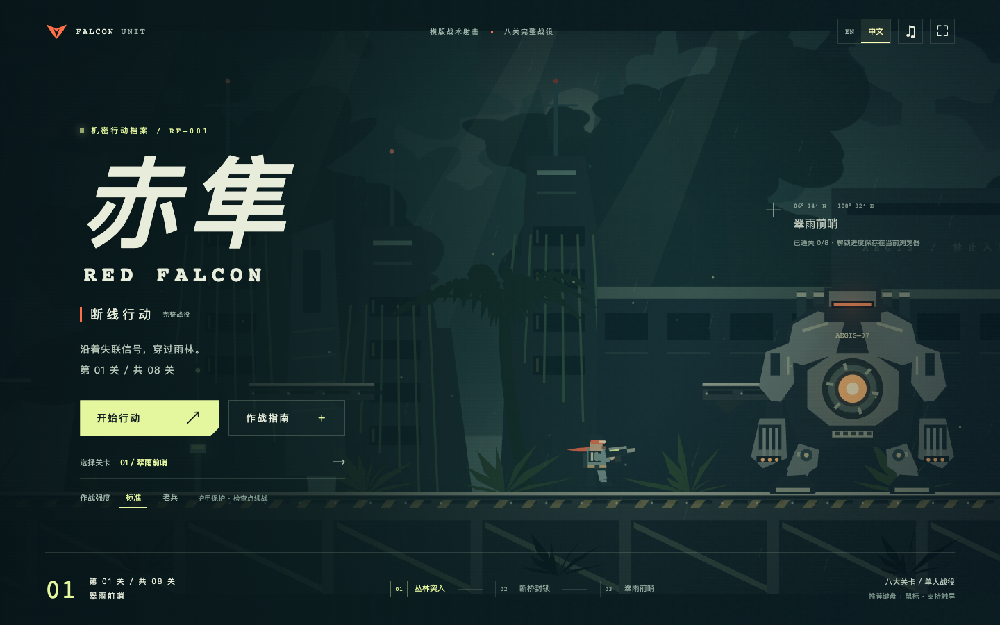
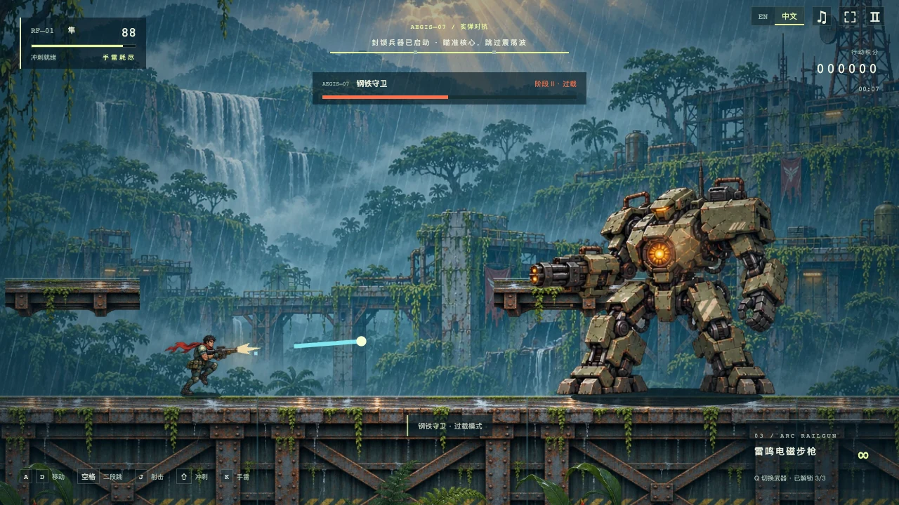

# 赤隼 · 断线行动

[English](README.md) | [简体中文](README.zh-CN.md)

**[在线试玩](https://red-falcon-broken-signal.arronstudio.chatgpt.site)** — 打开浏览器即可游玩，无需登录或安装。

**原创浏览器横版跑跳射击游戏，包含八关完整战役。**

从雨林前哨出发，穿过堡垒、瀑布、工业废墟，最终进入地下活体巢穴，追踪失联信号。
赤隼以经典横版动作游戏为灵感，重新设计了八关战役、角色、Boss 与声音。

基于浏览器原生 Canvas 2D 和 Web Audio，无运行时依赖。所有素材由游戏自身提供，无需第三方 CDN。



## 新版画面可玩样板

**[试玩前 30 秒](https://red-falcon-broken-signal.arronstudio.chatgpt.site/?sample=intro)** · **[直接挑战 AEGIS–07](https://red-falcon-broken-signal.arronstudio.chatgpt.site/?sample=boss)**

雨林废墟、潮湿金属与岩壁、八帧跑动、方向瞄准、跳跃落地姿态，以及带蓄力预警的守卫战。
默认英文，可在右上角切换中文。突入段累计游玩 30 秒后，可进入 Boss 战；Boss 练习会补满护甲并解锁三种武器。样板与战役解锁和最高分分开。



五张 WebP 图集共约 2 MB，仅在进入样板时加载。静态光照与地形使用缓存，只绘制可见角色，粒子上限为 240。
[实现与性能实测](docs/visual-slice/README.md)记录了测试条件、结果与设备验证范围。

## 快速开始

需要 **Node.js 20+** 和现代浏览器。无需安装依赖即可运行。

```sh
git clone https://github.com/aaronguostudio/red-falcon.git
cd red-falcon
npm run dev
```

打开 [本地游戏](http://red-falcon.localhost:4177)。推荐桌面浏览器全屏游玩。

`dist/` 直接存放 HTML、CSS 和 JavaScript 源码，不是生成的构建产物。
将该目录发布到任意静态网站托管服务即可，无需构建。
`.openai/hosting.json` 对应原站点的 Sites 配置；自行托管时不需要该配置。

## 操作

| 动作 | 键位 |
| --- | --- |
| 移动 | A / D 或左右方向键 |
| 二段跳 | K / 空格 |
| 蹲下射击 | 在地面按住下方向键 / S |
| 连射 | 按住 J；或鼠标左键瞄准射击 |
| 上下瞄准 | W / 上方向键向上；空中 S / 下方向键向下 |
| 无敌冲刺 | Shift / H |
| 手雷 | L / 鼠标右键 |
| 切换已解锁武器 | Q |
| 暂停 / 声音 / 全屏 | Esc / M / F |

蹲下时降低受击范围、原地保持脚底位置，并可射击。松开站起，按 K / 空格可直接从蹲姿起跳。样板与完整战役使用相同键位。

触屏设备提供虚拟按钮（含按住蹲下），建议横屏。每关的标准与老兵难度分别保存最高分。
通关后解锁下一关，也可通过 **选择关卡** 重玩已解锁关卡。浏览器允许存储时，
解锁进度与最高分保存在当前浏览器，不跨设备同步。检查点仅在当前任务内有效；
刷新页面或返回主界面后，本关需重新开始。每关从脉冲步枪起步，沿途可拾取武器升级。

## 完整战役

| 关卡 | 环境与挑战 | Boss |
| --- | --- | --- |
| 01 · 翠雨前哨 | 雨林、断桥与前线阵地 | 钢铁守卫 |
| 02 · 通讯堡垒 | 堡垒走廊与定时激光喷口 | 壁垒之眼 |
| 03 · 瀑布峡谷 | 急流、悬空平台与二段跳跨越 | 风暴鳐 |
| 04 · 熔炉工厂 | 双向传送带与炉火喷口 | 熔炉履带兽 |
| 05 · 冰封边境 | 冰面惯性、冰川裂缝与冰雾喷口 | 霜冻尖塔 |
| 06 · 废弃铁路 | 货运平台与标记炮击 | 攻城机车 |
| 07 · 离子核心 | 反应单元、能量喷口与蓄能光束 | 棱镜监守者 |
| 08 · 最终巢穴 | 活体地形、孢子喷口与无人机群 | 信号之主 |

每关均有独立设计的路线、三个区域、三个检查点、专属 Boss，以及任务简报与结尾。
最终 Boss 包含三个阶段，其余 Boss 为两阶段。攻击模式涵盖瞄准弹幕、震荡波、
标记轰炸、蓄能光束、交叉火力、螺旋弹幕、低空扫射与无人机召唤。

- 四类敌人：步兵、重装兵、炮塔与无人机。
- 脉冲步枪、蜂群散射炮、雷鸣电磁步枪、手雷与可破坏补给箱。
- 二段跳、无敌冲刺，以及补满护甲和手雷的自动检查点。
- 每关独立计时、连杀积分、通关评级与检查点续战。
- 关卡选择、逐关解锁与完整战役结局。

场景、角色与机械结构均由程序绘制；每关都有独立配色、建筑、氛围与 Boss 造型。
粒子、冲刺残影、命中停顿、震屏与天气丰富战斗反馈。音效与节奏轨由 Web Audio
实时合成。开启系统减少动态效果时禁用震屏。

## 验证与开发

```sh
npm run check
npm test
```

测试覆盖跳跃和冲刺、射击碰撞、武器拾取、手雷、检查点恢复、暂停、难度和
Boss 阶段。八关分别通过仅使用正常操作输入的完整通关模拟。战役测试还覆盖
安全检查点、顺序解锁、最高分存储、损坏或禁用的存储、关卡切换与最终 Boss 阶段。

| 文件 | 职责 |
| --- | --- |
| [game.js](dist/src/game.js) | 与 DOM 无关的游戏模拟 |
| [levels.js](dist/src/levels.js) | 八关路线、敌人配置、关卡文案与 Boss 定义 |
| [patterns.js](dist/src/patterns.js) | Boss 攻击模式与危险区域碰撞 |
| [progress.js](dist/src/progress.js) | 浏览器内的解锁进度与最高分 |
| [render.js](dist/src/render.js) | Canvas 绘制与视觉效果 |
| [scenes.js](dist/src/scenes.js) | 各关场景、环境效果与 Boss 绘制 |
| [audio.js](dist/src/audio.js) | 合成音效与音乐 |
| [i18n.js](dist/src/i18n.js) | 中英文文案与语言偏好保存 |
| [main.js](dist/src/main.js) | 输入处理与界面 |
| [game.test.mjs](tests/game.test.mjs) | 核心游戏逻辑与第一关测试 |
| [campaign.test.mjs](tests/campaign.test.mjs) | 八关通关、进度与机制测试 |

只读的 `window.redFalcon.snapshot()` 提供调试状态，不含作弊或跳关接口。

## 语言与范围

仓库以英文为主。两版 README 提供对应的项目介绍、运行方式、操作说明和开发信息，
命令与文件路径保持一致。游戏默认英文，可在顶部或作战指南中的 **EN / 中文**
即时切换，语言选择会保存在当前浏览器。菜单、战斗提示、Boss 预警、触屏按钮
和结算信息均支持两种语言，切换时保留当前关卡进度。

本版本包含完整的八关原创单人浏览器战役，当前范围不包含联机与手柄适配。
